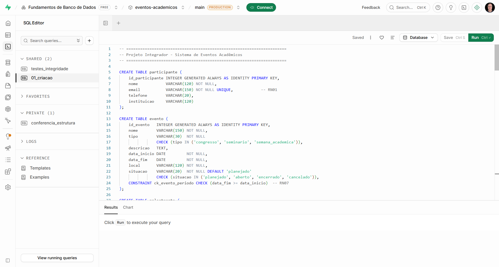
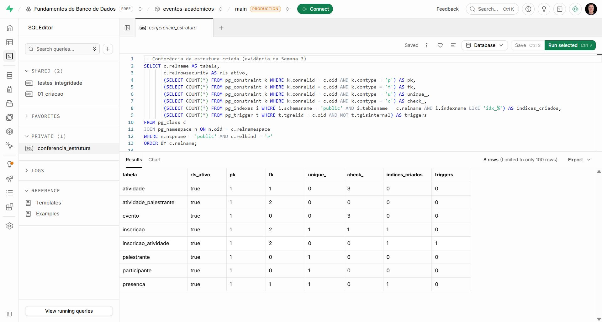
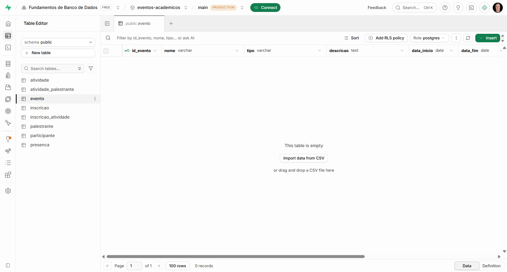
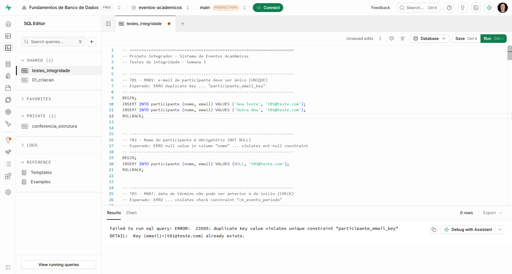
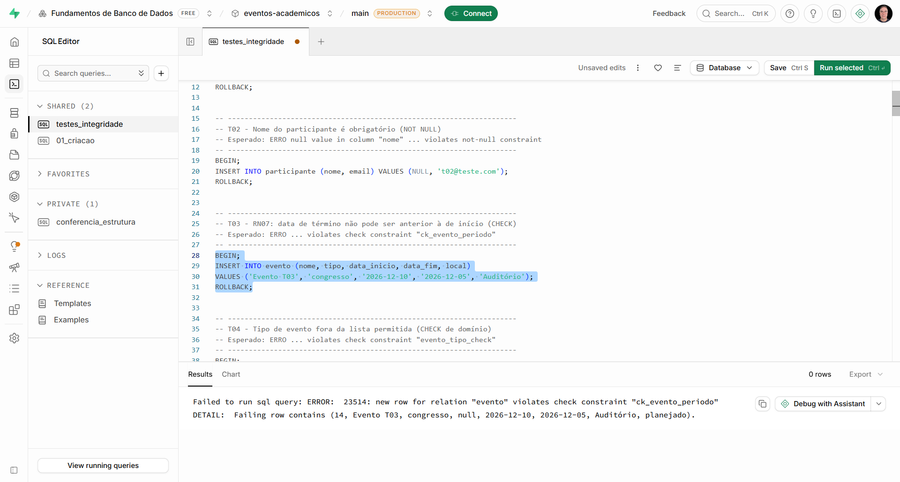
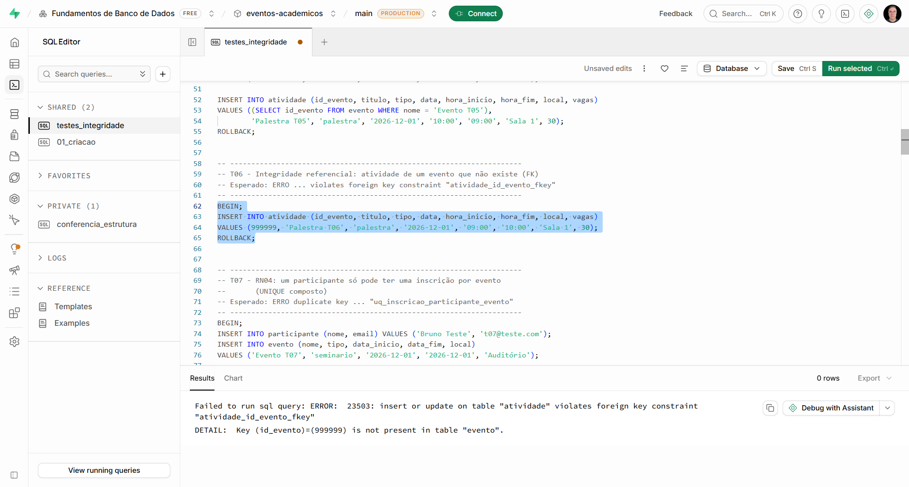
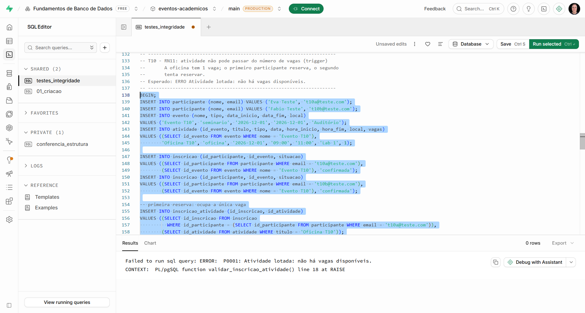
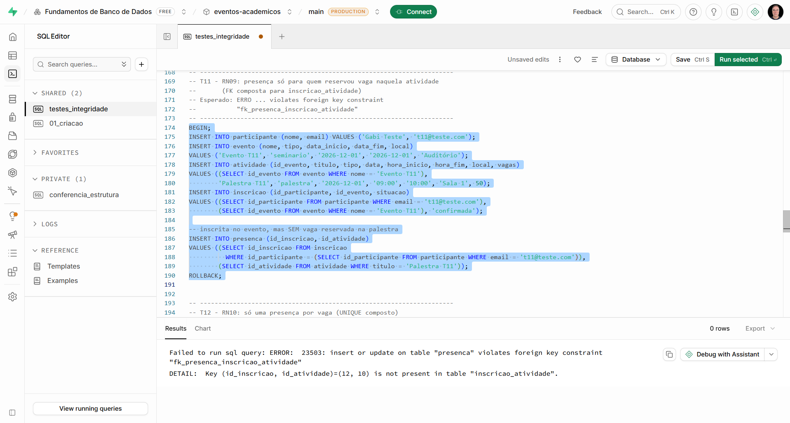
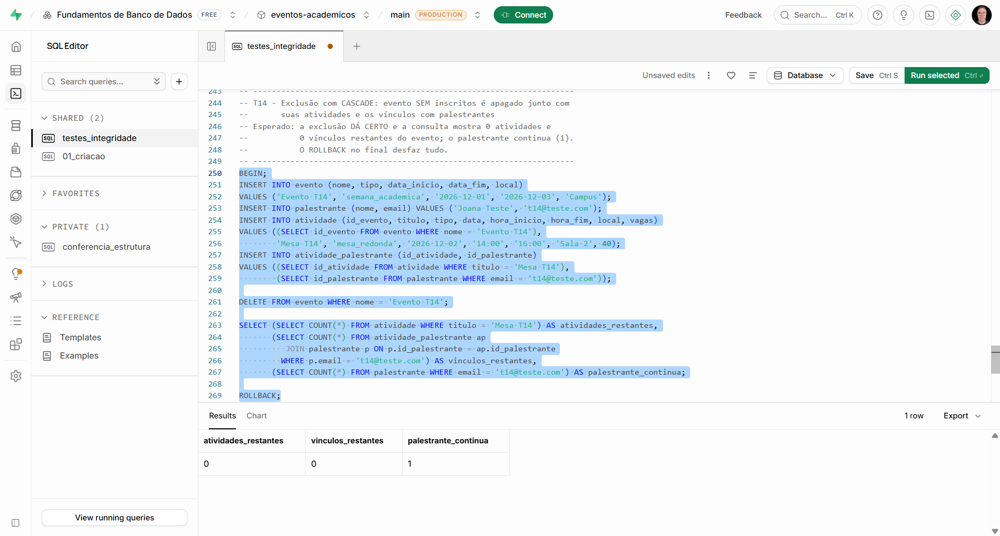

# Sistema de Eventos Acadêmicos

### Semana 3 — Implementação Física no PostgreSQL/Supabase

> **Projeto Integrador — Banco de Dados Ponta a Ponta**
> O banco está implementado no Supabase com as **8 tabelas** do modelo lógico da Semana 2, **11 restrições** além das PK e FK (7 `CHECK` e 4 `UNIQUE`), `NOT NULL`, `DEFAULT`, **3 índices** e **1 trigger** para as regras que envolvem mais de uma tabela.

| Campo | Informação |
|---|---|
| **Disciplina** | Fundamentos de Banco de Dados |
| **Professor** | Gustavo Prado |
| **Cenário** | Cenário 4 — Sistema de Eventos Acadêmicos |
| **Integrantes** | Felipe Nogueira, Alfredo Vicente, Lorrane Yamada, Victor Hugo, Gabriel Soares |

---

## Sumário

1. [Ambiente e evidências](#1--ambiente-e-evidências)
2. [Dicionário de dados](#2--dicionário-de-dados)
3. [Restrições de integridade e índices](#3--restrições-de-integridade-e-índices)
4. [Comportamento na exclusão de registros](#4--comportamento-na-exclusão-de-registros)
5. [Testes de integridade](#5--testes-de-integridade)
6. [Pontos de atenção para a Semana 4](#6--pontos-de-atenção-para-a-semana-4)

**Arquivos desta semana:**

| Arquivo | Conteúdo |
|---|---|
| [`01_criacao.sql`](01_criacao.sql) | Script de criação: tabelas, chaves, restrições, trigger e índices |
| [`testes_integridade.sql`](testes_integridade.sql) | 14 testes de integridade, cada um entre `BEGIN` e `ROLLBACK` |
| [`evidencias/`](evidencias/) | Prints da execução no Supabase (9 imagens) |

---

## 1 · Ambiente e evidências

O script `01_criacao.sql` foi executado **uma única vez** no SQL Editor e terminou com *"Success. No rows returned"*.

| Item | Valor |
|---|---|
| **Plataforma** | Supabase (PostgreSQL 17.12), plano gratuito |
| **Projeto** | `eventos-academicos` |
| **Script executado** | `01_criacao.sql`, salvo no SQL Editor com o mesmo nome e compartilhado com a equipe |
| **Segurança** | Row Level Security ativado nas 8 tabelas |
| **Consultas salvas** | `conferencia_estrutura` e `testes_integridade` |
| **DER** | Sem alterações desde a Semana 2 |

Resultado da consulta `conferencia_estrutura`, que lê o catálogo do PostgreSQL:

| Tabela | RLS | PK | FK | UNIQUE | CHECK | Índices | Triggers |
|---|:-:|:-:|:-:|:-:|:-:|:-:|:-:|
| `atividade` | sim | 1 | 1 | 0 | 3 | 0 | 0 |
| `atividade_palestrante` | sim | 1 | 2 | 0 | 0 | 0 | 0 |
| `evento` | sim | 1 | 0 | 0 | 3 | 0 | 0 |
| `inscricao` | sim | 1 | 2 | 1 | 1 | 1 | 0 |
| `inscricao_atividade` | sim | 1 | 2 | 0 | 0 | 1 | 1 |
| `palestrante` | sim | 1 | 0 | 1 | 0 | 0 | 0 |
| `participante` | sim | 1 | 0 | 1 | 0 | 0 | 0 |
| `presenca` | sim | 1 | 1 | 1 | 0 | 1 | 0 |

### Evidências

**Evidência 1 — Script `01_criacao.sql` salvo no SQL Editor**

**Evidência 2 — Consulta `conferencia_estrutura`: 8 tabelas com RLS, chaves, restrições, índices e trigger**

**Evidência 3 — Table Editor com as 8 tabelas**

Os prints dos testes (T01, T03, T06, T10, T11 e T14) estão na [seção 5](#5--testes-de-integridade).

---

## 2 · Dicionário de dados

Os ids são gerados pelo banco (`GENERATED ALWAYS AS IDENTITY`); as tabelas associativas usam a combinação das FKs como chave.

### `participante` — pessoas que se inscrevem nos eventos

| Coluna | Tipo | Nulo | Chave / restrição | Descrição |
|---|---|:-:|---|---|
| `id_participante` | INTEGER identity | não | PK | Identificador do participante |
| `nome` | VARCHAR(120) | não | — | Nome completo |
| `email` | VARCHAR(150) | não | UNIQUE (RN01) | E-mail, único no sistema |
| `telefone` | VARCHAR(20) | sim | — | Telefone de contato |
| `instituicao` | VARCHAR(120) | sim | — | Instituição de origem |

### `evento` — congressos, seminários e semanas acadêmicas

| Coluna | Tipo | Nulo | Chave / restrição | Descrição |
|---|---|:-:|---|---|
| `id_evento` | INTEGER identity | não | PK | Identificador do evento |
| `nome` | VARCHAR(150) | não | — | Nome do evento |
| `tipo` | VARCHAR(30) | não | CHECK: congresso, seminario, semana_academica | Tipo do evento |
| `descricao` | TEXT | sim | — | Descrição livre |
| `data_inicio` | DATE | não | — | Primeiro dia |
| `data_fim` | DATE | não | CHECK `data_fim >= data_inicio` (RN07) | Último dia |
| `local` | VARCHAR(120) | não | — | Local de realização |
| `situacao` | VARCHAR(20) | não | CHECK: planejado, aberto, encerrado, cancelado; DEFAULT planejado | Situação do evento |

### `palestrante` — pessoas que conduzem as atividades

| Coluna | Tipo | Nulo | Chave / restrição | Descrição |
|---|---|:-:|---|---|
| `id_palestrante` | INTEGER identity | não | PK | Identificador do palestrante |
| `nome` | VARCHAR(120) | não | — | Nome completo |
| `email` | VARCHAR(150) | não | UNIQUE | E-mail, único entre palestrantes |
| `area_atuacao` | VARCHAR(100) | sim | — | Área de atuação |
| `minicurriculo` | TEXT | sim | — | Resumo do currículo |

### `atividade` — palestras, minicursos, mesas-redondas e oficinas de um evento

| Coluna | Tipo | Nulo | Chave / restrição | Descrição |
|---|---|:-:|---|---|
| `id_atividade` | INTEGER identity | não | PK | Identificador da atividade |
| `id_evento` | INTEGER | não | FK → evento, ON DELETE CASCADE (RN02) | Evento ao qual pertence |
| `titulo` | VARCHAR(150) | não | — | Título |
| `tipo` | VARCHAR(30) | não | CHECK: palestra, minicurso, mesa_redonda, oficina | Tipo da atividade |
| `data` | DATE | não | — | Dia da atividade |
| `hora_inicio` | TIME | não | — | Horário de início |
| `hora_fim` | TIME | não | CHECK `hora_fim > hora_inicio` (RN08) | Horário de término |
| `local` | VARCHAR(120) | não | — | Sala ou espaço |
| `vagas` | INTEGER | não | CHECK `vagas > 0` (RN11) | Lotação máxima |

### `atividade_palestrante` — associativa do N:N entre atividade e palestrante (RN06)

| Coluna | Tipo | Nulo | Chave / restrição | Descrição |
|---|---|:-:|---|---|
| `id_atividade` | INTEGER | não | PK composta; FK → atividade, ON DELETE CASCADE | Atividade |
| `id_palestrante` | INTEGER | não | PK composta; FK → palestrante, ON DELETE RESTRICT | Palestrante |

### `inscricao` — associativa do N:N entre participante e evento (RN03)

| Coluna | Tipo | Nulo | Chave / restrição | Descrição |
|---|---|:-:|---|---|
| `id_inscricao` | INTEGER identity | não | PK | Identificador da inscrição |
| `id_participante` | INTEGER | não | FK → participante, ON DELETE RESTRICT; UNIQUE com `id_evento` (RN04) | Quem se inscreveu |
| `id_evento` | INTEGER | não | FK → evento, ON DELETE RESTRICT | Em qual evento |
| `data_inscricao` | TIMESTAMP | não | DEFAULT data e hora atuais | Momento da inscrição |
| `situacao` | VARCHAR(20) | não | CHECK: pendente, confirmada, cancelada; DEFAULT pendente (RN05) | Situação da inscrição |

### `inscricao_atividade` — vaga reservada: associativa do N:N entre inscrição e atividade (RF09)

| Coluna | Tipo | Nulo | Chave / restrição | Descrição |
|---|---|:-:|---|---|
| `id_inscricao` | INTEGER | não | PK composta; FK → inscricao, ON DELETE RESTRICT | Inscrição no evento |
| `id_atividade` | INTEGER | não | PK composta; FK → atividade, ON DELETE RESTRICT | Atividade reservada |
| `data_inscricao` | TIMESTAMP | não | DEFAULT data e hora atuais | Momento da reserva |

### `presenca` — comparecimento a uma vaga reservada (1:1 com `inscricao_atividade`)

| Coluna | Tipo | Nulo | Chave / restrição | Descrição |
|---|---|:-:|---|---|
| `id_presenca` | INTEGER identity | não | PK | Identificador da presença |
| `id_inscricao` | INTEGER | não | FK composta → inscricao_atividade (RN09); UNIQUE com `id_atividade` (RN10) | Inscrição de quem compareceu |
| `id_atividade` | INTEGER | não | Parte da FK composta e do UNIQUE | Atividade frequentada |
| `data_hora_registro` | TIMESTAMP | não | DEFAULT data e hora atuais | Momento do registro |

---

## 3 · Restrições de integridade e índices

Além das PK e FK, o banco garante as regras de negócio com **7 CHECK**, **4 UNIQUE**, `NOT NULL` nas colunas obrigatórias, **4 DEFAULT** e **1 trigger**.

| Restrição | Tabela | Tipo | Regra garantida |
|---|---|---|---|
| `participante_email_key` | participante | UNIQUE | RN01: e-mail único |
| `palestrante_email_key` | palestrante | UNIQUE | E-mail único entre palestrantes |
| `uq_inscricao_participante_evento` | inscricao | UNIQUE composto | RN04: uma inscrição por participante em cada evento |
| `uq_presenca_inscricao_atividade` | presenca | UNIQUE composto | RN10: uma presença por vaga |
| `evento_tipo_check` | evento | CHECK | Tipo dentro da lista definida |
| `evento_situacao_check` | evento | CHECK | Situação dentro da lista definida |
| `ck_evento_periodo` | evento | CHECK | RN07: `data_fim >= data_inicio` |
| `atividade_tipo_check` | atividade | CHECK | Tipo dentro da lista definida |
| `ck_atividade_horario` | atividade | CHECK | RN08: `hora_fim > hora_inicio` |
| `ck_atividade_vagas` | atividade | CHECK | RN11: `vagas > 0` |
| `inscricao_situacao_check` | inscricao | CHECK | RN05: pendente, confirmada ou cancelada |
| `fk_presenca_inscricao_atividade` | presenca | FK composta | RN09: presença só para quem reservou vaga na atividade |
| `trg_validar_inscricao_atividade` | inscricao_atividade | Trigger | RN12: inscrição confirmada no evento da atividade; RN11: não passar do número de vagas |

**DEFAULT:** `evento.situacao = planejado`, `inscricao.situacao = pendente` e as datas de registro (`data_inscricao`, `data_hora_registro`) recebem a data e hora atuais.

> **Por que um trigger?** Um `CHECK` só enxerga a própria linha. As regras **RN11** e **RN12** dependem de outras tabelas (a situação da inscrição, o evento da atividade e a contagem de vagas ocupadas), então são verificadas por uma função executada **antes de cada INSERT** em `inscricao_atividade`.

### Índices

O PostgreSQL já cria índices para as PK e os UNIQUE. Os 3 índices abaixo cobrem FKs usadas nas consultas da Semana 4 que não estão no início de nenhum desses índices.

| Índice | Coluna | Justificativa |
|---|---|---|
| `idx_inscricao_evento` | `inscricao (id_evento)` | Contar e listar os inscritos de cada evento (pergunta 1 da Semana 1). O UNIQUE (`id_participante`, `id_evento`) começa por `id_participante` e não ajuda nessa busca |
| `idx_inscricao_atividade_atividade` | `inscricao_atividade (id_atividade)` | O trigger conta as vagas ocupadas por atividade a cada reserva (RN11). A PK começa por `id_inscricao` |
| `idx_presenca_atividade` | `presenca (id_atividade)` | Contar a participação em cada atividade (pergunta 2 da Semana 1) |

---

## 4 · Comportamento na exclusão de registros

O banco só apaga **em cascata** o que não tem sentido sem o registro principal; tudo que é histórico (inscrições, vagas e presenças) é protegido com **RESTRICT**.

| Ligação | ON DELETE | Efeito ao excluir o registro principal | Motivo |
|---|:-:|---|---|
| evento → atividade | CASCADE | As atividades do evento são apagadas junto | Atividade não existe sem evento (RN02) |
| atividade → atividade_palestrante | CASCADE | Os vínculos com palestrantes são apagados | O vínculo não tem sentido sem a atividade |
| palestrante → atividade_palestrante | RESTRICT | Impede excluir palestrante com atividade | Preserva quem conduziu cada atividade |
| participante → inscricao | RESTRICT | Impede excluir participante com inscrição | Preserva o histórico de inscrições |
| evento → inscricao | RESTRICT | Impede excluir evento com inscritos | Evento com inscritos deve ser cancelado, não apagado |
| inscricao → inscricao_atividade | RESTRICT | Impede excluir inscrição com vaga reservada | A inscrição deve mudar para cancelada |
| atividade → inscricao_atividade | RESTRICT | Impede excluir atividade com vagas reservadas | Preserva quem tinha direito à sala |
| inscricao_atividade → presenca | RESTRICT | Impede excluir vaga com presença registrada | Presença é base para a frequência |

**Na prática:** um evento só pode ser excluído enquanto não tiver inscritos, e aí suas atividades e os vínculos com palestrantes saem junto. Depois que há inscrições, a forma correta de encerrar um evento é mudar a situação para `cancelado`. Os testes **T13** e **T14** demonstram os dois casos.

---

## 5 · Testes de integridade

Foram elaborados **14 testes**: 13 tentativas de operações inválidas, todas recusadas pelo banco, e 1 exclusão válida em cascata. Cada teste roda entre `BEGIN` e `ROLLBACK`, então **nada fica gravado** na base definitiva.

Os comandos estão em [`testes_integridade.sql`](testes_integridade.sql), também salvo no SQL Editor do projeto. No Supabase, cada teste é executado separadamente: seleciona-se o bloco do teste e clica-se em **Run**.

| Teste | Regra | Operação tentada | Resultado obtido |
|:-:|---|---|---|
| **T01** | RN01 — e-mail único | Dois participantes com o mesmo e-mail | ❌ Recusado: `duplicate key value violates unique constraint "participante_email_key"` |
| **T02** | NOT NULL | Participante sem nome | ❌ Recusado: `null value in column "nome" violates not-null constraint` |
| **T03** | RN07 — período do evento | Evento terminando antes de começar | ❌ Recusado: `violates check constraint "ck_evento_periodo"` |
| **T04** | Domínio do tipo | Evento do tipo "festa" | ❌ Recusado: `violates check constraint "evento_tipo_check"` |
| **T05** | RN08 — horário da atividade | Atividade das 10:00 às 09:00 | ❌ Recusado: `violates check constraint "ck_atividade_horario"` |
| **T06** | Integridade referencial | Atividade de um evento inexistente (id 999999) | ❌ Recusado: `violates foreign key constraint "atividade_id_evento_fkey"` |
| **T07** | RN04 — inscrição única | Mesma pessoa inscrita duas vezes no mesmo evento | ❌ Recusado: `duplicate key value violates unique constraint "uq_inscricao_participante_evento"` |
| **T08** | RN05 — situação da inscrição | Inscrição com situação "aprovada" | ❌ Recusado: `violates check constraint "inscricao_situacao_check"` |
| **T09** | RN12 — inscrição confirmada | Reserva de vaga com inscrição pendente | ❌ Recusado pelo trigger: *"Inscrição inválida: o participante precisa ter inscrição confirmada no evento da atividade."* |
| **T10** | RN11 — limite de vagas | Segunda reserva em oficina de 1 vaga | ❌ Recusado pelo trigger: *"Atividade lotada: não há vagas disponíveis."* |
| **T11** | RN09 — presença com vaga | Presença de inscrita sem vaga na palestra | ❌ Recusado: `violates foreign key constraint "fk_presenca_inscricao_atividade"` |
| **T12** | RN10 — presença única | Segunda presença na mesma vaga | ❌ Recusado: `duplicate key value violates unique constraint "uq_presenca_inscricao_atividade"` |
| **T13** | Exclusão com RESTRICT | Apagar evento que tem inscrito | ❌ Recusado: `violates foreign key constraint "inscricao_id_evento_fkey" on table "inscricao"` |
| **T14** | Exclusão com CASCADE | Apagar evento sem inscritos, com uma atividade e um palestrante vinculado | ✅ Aceito: 0 atividades e 0 vínculos restantes; o palestrante continua cadastrado (1) |

> Os 14 testes foram executados em **16/11/2026** no projeto `eventos-academicos` do Supabase (PostgreSQL 17.12), um de cada vez. As mensagens de erro do Supabase começam com o código do erro: `23505` para UNIQUE, `23502` para NOT NULL, `23514` para CHECK, `23503` para FK e `P0001` para o trigger. Nos testes T13 e T14, que têm `DELETE`, o Supabase mostra o aviso *"Potential issue detected"* antes de executar. Depois dos testes, uma contagem nas 8 tabelas confirmou **0 registros**: nenhum dado de teste ficou gravado.

### Evidências dos testes

**T01 — E-mail duplicado recusado (UNIQUE)**

**T03 — Evento terminando antes de começar recusado (CHECK)**

**T06 — Atividade de evento inexistente recusada (FK)**

**T10 — Reserva em atividade lotada recusada (trigger)**

**T11 — Presença sem vaga reservada recusada (FK composta)**

**T14 — Exclusão de evento sem inscritos em cascata (CASCADE)**

---

## 6 · Pontos de atenção para a Semana 4

- **Os ids não voltam com o ROLLBACK.** O contador de cada coluna identity avança mesmo quando a transação é desfeita. Depois dos testes, o primeiro evento cadastrado pode receber, por exemplo, o id 15. Por isso, o `02_populacao.sql` não deve supor ids fixos: deve buscar os ids por subconsulta ou reiniciar os contadores antes de inserir.
- **Reaproveitar os testes.** O `04_testes.sql` da Semana 4 pede testes de integridade e de manipulação (`INSERT`, `UPDATE` e `DELETE`). Os 14 testes desta semana podem ser a primeira parte desse script.
- **`baseSqlAfter2ndWeek.sql`.** O arquivo da raiz do repositório foi corrigido (faltava o `);` no fim da tabela `atividade`), mas ele é só a versão do modelo para o DrawDB. O script oficial de criação é o [`01_criacao.sql`](01_criacao.sql).

---

  Projeto Integrador · Banco de Dados · Prof. Gustavo Prado · Instituto Federal do Triângulo Mineiro (IFTM)

